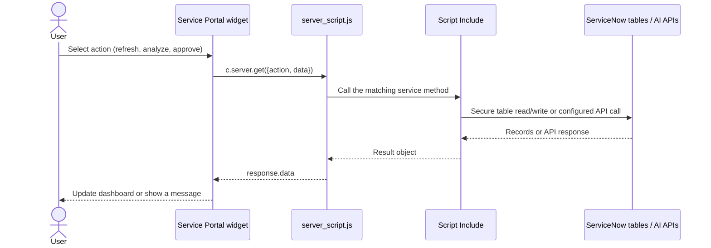
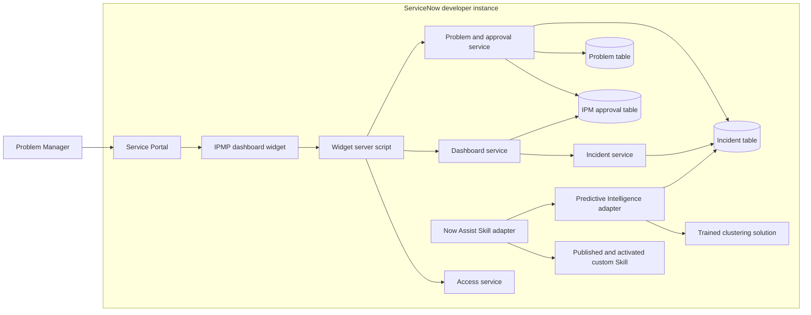
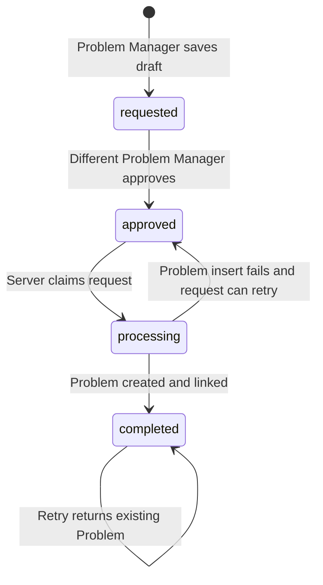

# SNOW-SDK-PROJECT-TEST-APP

This folder is a ServiceNow scoped application built with the ServiceNow SDK and Fluent. It contains the source code for an incident investigation dashboard and a manager-approved Problem creation workflow.

The project uses **JavaScript for application behavior**. Fluent metadata files end in `.now.ts`; they describe ServiceNow records such as tables, ACLs, Script Includes, and Service Portal records. They do not mean that all business logic must be written in TypeScript.

## What the app does

- Shows Incidents the signed-in user can read, with priority and state filters and paging.
- Groups repeated short descriptions and configuration items as a lightweight heuristic. These groups are clues for investigation, not verified causes.
- Can request clusters from a configured Predictive Intelligence clustering solution. The current dashboard reports how many clusters were returned; it does not yet show the cluster summaries and example Incidents as a detailed list.
- Can send an Incident to a configured Now Assist custom Skill and use its response to prefill an editable Problem draft.
- Saves a draft for a second Problem Manager to review. The server checks the saved approval before it creates a Problem.

Predictive Intelligence and Now Assist need additional setup on the instance. Installing this app does not create or train an ML solution and does not create, publish, or activate a Now Assist Skill.

## Start developing this app

Run the following commands from this folder:

```bash
npm install
npm run types       # optional: download instance dependencies/types
npm run build
npm run deploy
```

`npm run deploy` runs `now-sdk install` using the SDK authentication alias configured on your computer. You can also see more installation detail with:

```bash
npm run deploy -- --debug
```

The account used by the SDK must have the required ServiceNow application development access; the SDK install guide lists `admin` as the required role. See the [ServiceNow SDK build and install guide](https://www.servicenow.com/docs/r/application-development/servicenow-sdk/build-deploy-application-now-sdk.html) and [authentication guide](https://www.servicenow.com/docs/r/application-development/servicenow-sdk/authenticate-instance-now-sdk.html).

This app's current scope is `x_412550_ipmp`, which matches the vendor prefix shown by the developer instance used for this project. **A different instance can have a different vendor prefix.** Before installing on another instance, check its prefix and use a matching scope; update related references together if the scope changes.

After a successful install, the portal URL for the current scope is:

```text
https://<instance>.service-now.com/x_412550_ipmp_ipm?id=x_412550_ipmp_ipm_dashboard
```

## Start a separate ServiceNow SDK app

Use `now-sdk init` to start a project. The older `now-sdk create` command is not the command used by this SDK version.

```bash
mkdir my-servicenow-app
cd my-servicenow-app
now-sdk init
```

In the prompts, choose a template, app name, NPM package name, and scoped app. Enter a scope beginning with the vendor prefix for the target instance. Then install dependencies, build, and install:

```bash
npm install
now-sdk build
now-sdk install --debug
```

Keep each app in its own folder with its own `package.json` and `now.config.json`. Do not initialize a new app inside another SDK app's folder. For the complete workflow, see [Create an application with the SDK](https://www.servicenow.com/docs/r/application-development/servicenow-sdk/create-application-now-sdk.html).

## Project structure

```text
snow-sdk-project/
├── package.json
├── package-lock.json
├── now.config.json
├── README.md
└── src/
    ├── jsconfig.json
    ├── jsconfig.client.json
    ├── jsconfig.server.json
    ├── fluent/
    │   ├── generated/
    │   │   └── keys.ts
    │   └── ipmp/
    │       ├── approval-table.now.ts
    │       ├── approval-form.now.ts
    │       ├── properties.now.ts
    │       ├── security.now.ts
    │       ├── script-includes/
    │       │   └── *.now.ts
    │       └── service-portal/
    │           ├── portal.now.ts
    │           ├── page.now.ts
    │           ├── widget.now.ts
    │           ├── template.html
    │           ├── styles.css
    │           ├── client_script.js
    │           └── server_script.js
    └── server/
        └── script-includes/
            ├── IPMAccessService.js
            ├── IPMAnalysisService.js
            ├── IPMDashboardService.js
            ├── IPMIncidentService.js
            ├── IPMPredictiveService.js
            └── IPMProblemService.js
```

The SDK also creates build output under `dist/` and a ZIP package under `target/`. These are generated files. Edit files in `src/`, then build again. `src/fluent/generated/keys.ts` is generated by the SDK; do not edit it by hand.

## Frontend and backend

### Frontend

The frontend is the Service Portal widget in `src/fluent/ipmp/service-portal/`:

- `template.html` defines the dashboard elements and binds them to widget data.
- `styles.css` controls the layout, colors, spacing, and responsive behavior.
- `client_script.js` handles browser actions: loading data, filters, selecting an Incident, requesting analysis, and sending approval actions.
- `server_script.js` is the widget's server-side entry point. It receives the requested action and calls a Script Include.
- `widget.now.ts`, `page.now.ts`, and `portal.now.ts` declare the widget, the page that holds it, and the portal URL.

The browser script does **not** query ServiceNow tables directly. It asks the widget server script for data with `c.server.get(...)`.

### Backend

The backend is in `src/server/script-includes/`. These files use ServiceNow server APIs such as `GlideRecordSecure`, `gs`, and `Class.create()`:

- `IPMAccessService.js` checks the user's role and table access.
- `IPMIncidentService.js` reads, filters, pages, and maps Incidents.
- `IPMDashboardService.js` combines Incident data, KPIs, heuristic patterns, and approval summaries.
- `IPMPredictiveService.js` calls the configured Predictive Intelligence clustering solution and filters example Incidents through secure reads.
- `IPMAnalysisService.js` calls the configured Now Assist Skill through OneExtend and maps its response into draft fields.
- `IPMProblemService.js` stores approval requests, checks manager approval, creates Problems, and links Incidents when the instance's schema and ACLs allow it.

Files in `src/fluent/ipmp/script-includes/` register the JavaScript Script Includes as scoped ServiceNow Script Include records. Their `.now.ts` files are metadata; the corresponding `.js` files contain the behavior.

## How a frontend request reaches the backend



The action names currently routed by `server_script.js` are `load_dashboard`, `analyze_incident`, `request_approval`, `approve_request`, and `create_problem`.

## High-level design (HLD)



The SDK/Fluent source is the authoring layer. `now-sdk build` turns it into ServiceNow application metadata and modules. `now-sdk install` sends that package to the instance. The portal and server logic then run inside ServiceNow.

## Low-level design (LLD)

### Dashboard read path

1. The widget opens and `client_script.js` requests `load_dashboard`.
2. `server_script.js` creates the dashboard service and calls `getDashboardData()`.
3. `IPMAccessService` checks the current user's role and Incident read access.
4. `IPMIncidentService` reads Incidents with `GlideRecordSecure`, applies supported filters and paging, then returns a small JSON object per Incident.
5. `IPMDashboardService` calculates summary counts and repeated-description groups for the current result page.
6. The widget receives the result and renders it in `template.html`.

The dashboard's search box filters the currently loaded page in the browser. Priority and state filters are sent to the server. The repeated-description grouping is a heuristic based on matching short descriptions and CIs; it is not Predictive Intelligence.

### Predictive Intelligence path

1. An authorized user selects **Load PI clusters**.
2. The server reads the `x_412550_ipmp.ipm.cluster_solution` system property.
3. `IPMPredictiveService` obtains the configured active clustering solution using `sn_ml.MLSolutionFactory`.
4. It reads cluster summaries and top assignments, then looks up example Incidents with `GlideRecordSecure` before returning the data to the widget. The current template shows the cluster count and a message; rendering each summary and example Incident is a future UI enhancement.

The Predictive Intelligence API requires the **Predictive Intelligence** plugin (`com.glide.platform_ml`). It is different from Performance Analytics. Create and train a clustering solution for Incident data, then set the system property to the solution's technical name. The adapter cannot show meaningful clusters until this is configured. See [Install Predictive Intelligence](https://www.servicenow.com/docs/r/intelligent-experiences/predictive-intelligence/install-predictive-intelligence.html) and the [MLSolution API](https://www.servicenow.com/docs/r/api-reference/server-api-reference/MLSolutionAPI.html).

### Now Assist analysis and draft path

1. A user selects an Incident and clicks **Analyze with Now Assist**.
2. `IPMAnalysisService` verifies access, sends the Incident record input to `sn_one_extend.OneExtendUtil.execute()`, and parses `model_output`.
3. If configured, it also adds a JSON string containing PI cluster context as a second Skill input.
4. The widget displays the analysis and prefills the Problem draft fields. A manager can edit the draft before requesting approval.

The Skill must be created in Now Assist Skill Kit, tested, published, and activated in Now Assist Admin. The instance properties for capability ID, Skill configuration ID, and input names must match that Skill. The code follows ServiceNow's [custom Skill script pattern](https://www.servicenow.com/docs/r/intelligent-experiences/now-assist-skill-kit/call-custom-skill-from-script.html).

### Approval and Problem creation path



The browser sends a draft only when requesting approval. The server saves the draft and selected Incident IDs in `x_412550_ipmp_ipm_approval`. To create a Problem, the browser sends only the saved approval sys_id. The server requires a persisted `approved` state and a different approver, then creates the Problem. It returns the existing Problem for a completed request to reduce duplicate creation. If processing is interrupted, an admin may need to reconcile the approval record before retrying.

## Fluent metadata and application records

| Source file | ServiceNow record or purpose |
| --- | --- |
| `approval-table.now.ts` | Creates the custom IPM approval table and fields. |
| `approval-form.now.ts` | Defines the approval form layout. |
| `security.now.ts` | Defines the Problem Manager role and ACLs for approval records. |
| `properties.now.ts` | Creates configurable system properties for the role, PI solution, and Now Assist Skill. |
| `script-includes/*.now.ts` | Registers Script Includes and maps their names to JavaScript source files. |
| `service-portal/portal.now.ts` | Defines the Service Portal and URL suffix. |
| `service-portal/page.now.ts` | Defines the dashboard page and layout. |
| `service-portal/widget.now.ts` | Connects HTML, CSS, client script, and server script into a widget. |

## Configure the instance features

### Predictive Intelligence

1. In **System Definition → Plugins**, verify or activate **Predictive Intelligence** (`com.glide.platform_ml`). This requires admin access and may depend on instance entitlements.
2. Create a clustering solution for the Incident table and train it with suitable historical records and fields.
3. Set `x_412550_ipmp.ipm.cluster_solution` to the solution's technical name.
4. Open the dashboard and select **Load PI clusters**.

Do not install a Performance Analytics plugin for this API. Performance Analytics uses different functionality.

### Now Assist custom Skill

1. Check that Now Assist Skill Kit and a supported Now Assist provider are available on the instance. Developer instances may not include every Now Assist product or entitlement.
2. Create a Skill in **Now Assist Skill Kit**. The author needs `sn_skill_builder.admin`; an admin activates the published Skill in Now Assist Admin. See the [Skill Kit role guide](https://www.servicenow.com/docs/r/intelligent-experiences/now-assist-skill-kit/na-skill-kit-roles.html).
3. Add a mandatory **Record** input named `incident`, with table `incident`.
4. To provide PI information to the prompt, add an optional **String** input named `cluster_context`. In this app's system properties, set `x_412550_ipmp.ipm.skill_context_input_name` to `cluster_context`.
5. Write and test a prompt that returns JSON in `model_output`. The app reads these keys when present: `executive_summary`, `common_symptoms`, `possible_causes`, `evidence`, `missing_information`, `recommended_actions`, `suggested_problem_short_description`, `suggested_problem_description`, and `investigation_recommendation`.
6. Configure access controls and role restrictions, test with representative Incidents, finalize and publish the Skill, and activate it.
7. Set the following properties to values from your Skill configuration:

   - `x_412550_ipmp.ipm.skill_capability_id`
   - `x_412550_ipmp.ipm.skill_config_id`
   - `x_412550_ipmp.ipm.skill_input_name` (usually `incident`)
   - `x_412550_ipmp.ipm.skill_context_input_name` (for example, `cluster_context`; leave blank if the Skill has no such input)

The prompt should distinguish evidence from hypotheses and return a draft for human review. Now Assist output does not confirm root cause or create the Problem directly.

## Roles and security

- `IPMAccessService` permits app actions to `admin`, the app role `x_412550_ipmp.problem_manager`, the standard `problem_manager` role, or the configured role property.
- Incident reads and Problem/approval writes use `GlideRecordSecure` and check record/field permissions.
- The approval table has read, create, and write ACLs for the app and standard Problem Manager roles; admins can override them.
- A requester cannot approve their own request.
- The server, not the browser, is the authority for approval state and Problem creation.
- Configure Skill ACLs and role restrictions in Now Assist Skill Kit; app role checks do not replace Skill Kit security controls.

## Common development workflow

1. Edit the appropriate source file under `src/`.
2. Run `npm run build` to validate Fluent and create a new package.
3. Run `npm run deploy` to install/update the app on the instance.
4. Refresh the Service Portal page and verify the feature in the target instance.
5. If someone changed app metadata directly on the instance, review and synchronize it before the next install with `now-sdk transform --auth <alias>`. The SDK documentation explains that instance metadata can otherwise conflict with local source.

Avoid `--reinstall` unless you have checked the effect first. It can remove instance metadata that is not present in the local package. The `--info true` option only reads information about the last installation; it does not install the app.

## Current limits to validate

- Predictive Intelligence requires an active, trained clustering solution whose table and fields match the Incident data and API.
- The Now Assist Skill's input names, capability ID, configuration ID, response format, permissions, and provider must match the instance configuration.
- The app checks `incident.problem_id` and `problem.first_reported_by_task` at runtime. Incident relationship fields and mandatory Problem fields vary by instance.
- Related Incident linking uses `incident.problem_id` only if the field exists and the current user can write it. Otherwise it uses the Problem's first-reported task link where available.
- Test the approval workflow, ACLs, Skill access, and Problem creation with representative user roles before using production data.

## Official references

- [ServiceNow SDK overview](https://www.servicenow.com/docs/r/application-development/servicenow-sdk/servicenow-sdk.html)
- [Create an application with the SDK](https://www.servicenow.com/docs/r/application-development/servicenow-sdk/create-application-now-sdk.html)
- [Build and install an SDK application](https://www.servicenow.com/docs/r/application-development/servicenow-sdk/build-deploy-application-now-sdk.html)
- [ServiceNow Fluent API](https://www.servicenow.com/docs/r/application-development/servicenow-sdk/servicenow-fluent.html)
- [Predictive Intelligence and MLSolution APIs](https://www.servicenow.com/docs/r/api-reference/server-api-reference/MLSolutionAPI.html)
- [Now Assist Skill Kit](https://www.servicenow.com/docs/r/intelligent-experiences/now-assist-skill-kit/using-now-assist-skill-kit.html)
